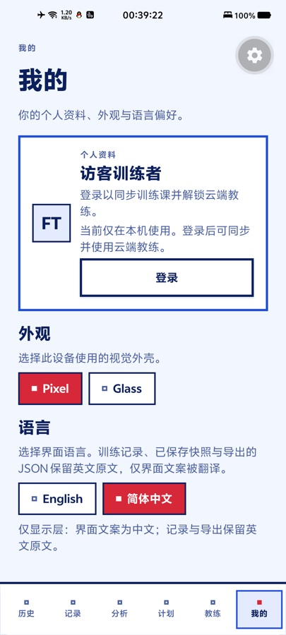
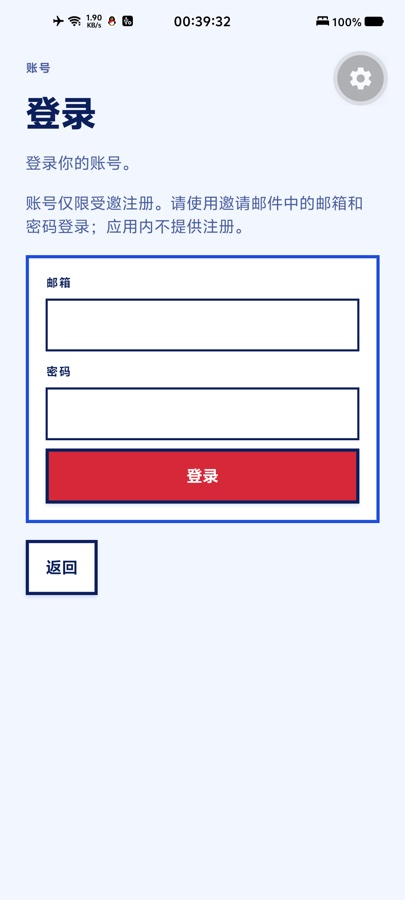
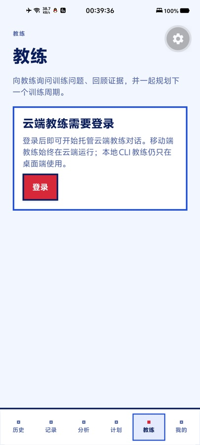
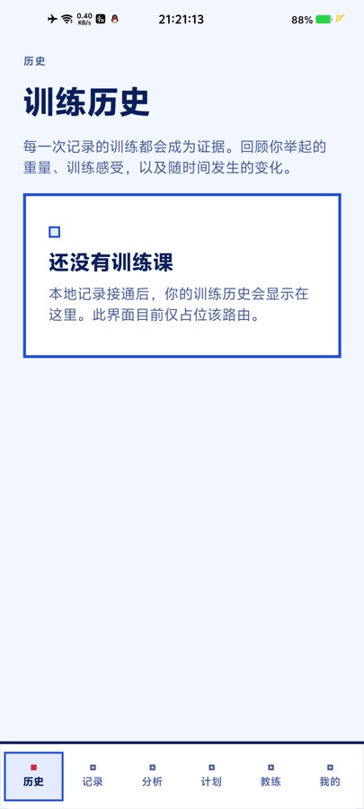
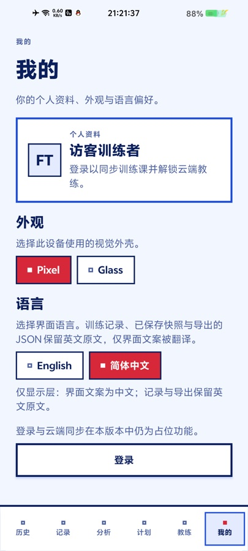
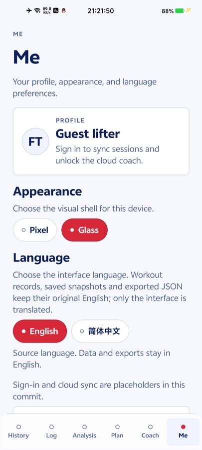

# Mobile app (React Native)

The Android-first React Native client lives in [`mobile/`](../mobile/) as
workspace package `@agent-fit-trace/mobile`. It reuses `@agent-fit-trace/core` for
deterministic domain logic and `@agent-fit-trace/api-contracts` for record and
transport shapes, so it does not fork validation, workout IDs, analysis or plan
rules. This is a status and plan record, not a second product contract: workout
semantics, transport, coaching and visual rules stay governed by
[`docs/mvp-design.md`](mvp-design.md), [`docs/api-contract.md`](api-contract.md),
[`docs/ui-design.md`](ui-design.md) and [`docs/deployment.md`](deployment.md).

## Status at PR4

The tree now contains the PR1 shell, the PR2 local-first data layer, the PR3
account, preference, sync and hosted-coach layer, and the PR4 unified mobile Log
session. **Implemented** means present in the tree; **planned** means designed but
not written. Android is the only configured native target.

| Area | Implemented now | Planned |
| --- | --- | --- |
| App and shell | Expo SDK 58, React Native 0.88, Expo Router, TypeScript strict; six-tab Pixel/Glass shell; shared UI primitives | Bundled fonts and full Glass polish |
| Local data | SQLite workout store plus the owner-scoped `session_draft` table (migration v2), migrations, validation on read and write; History, on-device Analysis and read-only Plan draft | Import/export parity; applying a draft plan |
| Workout session | One Log editor for after-the-fact and live sessions: start/pause/resume/finish, compact per-set rows (set number, kg, reps, RPE, completion check), per-exercise rest, owner-scoped draft restore/autosave/discard, haptics and a bundled rest cue | Background rest notifications; multi-device or multiple drafts |
| Accounts | Invite-only email/password sign-in, SecureStore session, restore/refresh/sign-out, account state on Me | Email verification and password-reset deep links |
| Account preferences | Skin and language mirrored to Supabase `user_metadata`; account wins on sign-in; write-through while signed in | — |
| Sync | Manual workout pull/push, content-ID idempotency and three device-only conflict choices | Background sync; persistent conflict acknowledgement |
| Hosted coach | Signed-in hosted coaching with session/snapshot/run flow, SSE, cancel and mapped errors | — |
| Notifications | None; coaching and sync are foreground-only. Rest cues are best-effort haptics/audio while the app is open, with no background service | Push notifications |
| Platforms | Android-first; EAS preview APK and linked Expo project | iOS build and device verification |
| Quality gates | Ten mobile `node:test` suites (141 tests), mobile typecheck and Android export pass locally | Mobile typecheck/export in CI |

## Architecture and boundaries

The client is local-first: the on-device database is the source of truth on that
device; the network is optional and adds accounts, account preferences, manual
sync and hosted coaching. A guest can use the app without an account or
connection.

Core owns domain logic, `api-contracts` record and transport shapes, and
`ui-tokens` visual values; `@agent-fit-trace/i18n` owns the render-time dictionary.
Presentation lives in `mobile/src/app` and `mobile/src/ui`. The adapters are
split by concern: `mobile/src/data` owns the SQLite store and the session-draft
repository, `mobile/src/workout` owns the native live-feedback adapters,
`mobile/src/auth` owns identity,
`mobile/src/preferences` reconciles account metadata, `mobile/src/sync` owns
manual workout sync and `mobile/src/coach` owns hosted coaching. The app embeds no
Node runtime, CLI launcher or local coach process and never receives a
service-role key; privileged work stays on the server and worker in
[`docs/deployment.md`](deployment.md).

### Repository layout

| Path | State | Role |
| --- | --- | --- |
| `mobile/src/app/` | Implemented | Routes: root stack, six tabs, invite-only sign-in, manual sync |
| `mobile/src/theme/` | Implemented | Shared tokens; AsyncStorage-backed skin state |
| `mobile/src/ui/` | Implemented | Button, Card, Chip, Field, ExerciseNameField, Banner, EmptyState, Screen, text |
| `mobile/src/data/` | Implemented | SQLite connection, schema and migrations, workout repository, session-draft repository and row mapping, analysis/plan models |
| `mobile/src/workout/` | Implemented | Native live feedback (haptics and the bundled `expo-audio` rest cue) |
| `mobile/src/auth/` | Implemented | Supabase sign-in, SecureStore session and auth provider |
| `mobile/src/preferences/` | Implemented | Account skin/language reconciliation provider |
| `mobile/src/sync/` | Implemented | Sync config, client, pure plan, runner and conflict/apply model |
| `mobile/src/coach/` | Implemented | Hosted coach config and client, SSE/reducer model and screen model |
| `mobile/src/i18n/` | Implemented | Language store and provider over the shared dictionary |
| `packages/fit-trace-ui-tokens/` | Implemented | Shared token contract for web and native |
| `packages/fit-trace-i18n/` | Implemented | Shared render-time dictionary and domain helpers |

The root layout nests `SafeAreaProvider`, `I18nProvider`, `SkinProvider`,
`WorkoutDataProvider`, `AuthProvider` and `PreferencesProvider`, in that order.
`index.tsx` opens History. The six tabs are History, Log, Analysis, Plan, Coach
and Me; Me hosts account, appearance, language, sign-out and the manual sync
entry. The sign-in and sync screens are stack routes outside the dock. There are
no placeholder tabs left.

## Data model

### Local store

`expo-sqlite` holds workouts in `fit-trace.db` inside the app sandbox. Reads and
writes go through the local store first, so logging, history, analysis and the
plan draft stay usable offline. Core validation runs before persistence, and
records are canonical JSON with the same field names and values as the API and
export shapes:

```json
{ "id": "wkt_2026-09-13_strength_1a2b3c4d", "schema_version": 1, "date": "2026-09-13",
  "session_type": "strength", "duration_minutes": 60, "exercises": [{ "name": "bench_press", "sets": [{ "weight": 80, "reps": 5, "rpe": 8 }] }] }
```

The shape is defined in
[`packages/fit-trace-core/src/types.ts`](../packages/fit-trace-core/src/types.ts).
Exercise names, notes, dates and source strings stay canonical English; interface
language never changes a stored record.

The `workouts` table keeps the canonical record in a `payload` column and
denormalized `id`, `schema_version`, `date`, `session_type` and `created_at`
columns; the payload remains the source of truth. Migrations are ordered and
transactional under `PRAGMA user_version`; setup requires WAL mode and closes
the handle if setup fails. Stored rows are re-validated on every read, and a
malformed row raises `CORRUPT_STORE` instead of being treated as absent or
returned as data.

Saves use `INSERT ... ON CONFLICT(id) DO NOTHING`. An identical re-save is a
no-op; the same id with different content is `CONFLICT`; there is no update or
replace path. The Log editor validates through the shared core before writing
and asks for explicit confirmation when valid input carries a warning, such as
zero reps. History orders records newest first by the instant the date denotes,
then by date text and id, so offset timestamps still sort correctly.

### Session draft

The unfinished live session is SQLite data too, but never in the append-only
workouts table. Migration v2 adds:

```sql
CREATE TABLE IF NOT EXISTS session_draft (
  owner_id TEXT PRIMARY KEY NOT NULL,
  payload TEXT NOT NULL,
  updated_at TEXT NOT NULL
);
```

- **One row per owner.** `owner_id` is the signed-in account id, or
  `local-guest` for a signed-out local user. A draft is therefore owner-scoped:
  sign-out or an account switch makes the previous owner's row unreachable, but
  does **not** delete it. There is no cross-device or multi-draft support.
- **Payload.** `payload` is the shared canonical-JSON session draft from
  `@agent-fit-trace/workout-session` (`encodeSessionDraft`/`decodeSessionDraft`),
  containing the date, session type, duration/sleep/notes, exercises, multiple
  pain reports and the persisted timing. Rest is transient runtime state and is
  never serialized, so a restart restores no countdown.
- **Migration is one-way.** Upgrading applies v2 once under `PRAGMA
  user_version`; the `workouts` table is untouched. Rolling back to an older
  build means forward-fixing or clearing app data. The payload version is a
  separate layer and has no migration path at all: an unsupported or malformed
  payload fails closed.
- **Restore and autosave.** The editor loads the owner's row before saving is
  enabled, and auto-pauses a timing that was still active at its
  `lastActiveAtMs`, so time while the process was dead is never counted. Each
  draft change is written after a 500 ms debounce through one serialized queue,
  with a flush when the app backgrounds and when the screen unmounts. A
  successful workout save clears the row only when the editor still holds the
  submitted draft for the same owner.
- **Failure handling.** Corruption (`SessionDraftCorruptionError`) or a
  transient read error starts a blank editor, shows a banner, blocks autosave
  and saves for that mount, and is never overwritten; both failures offer an
  explicit native discard confirmation. A write failure shows one banner and
  stops retrying.

### Workout IDs

Workout IDs are content-derived through
[`deriveWorkoutId`](../packages/fit-trace-api-contracts/src/deriveWorkoutId.ts):
the hash covers canonical content and excludes store-assigned `id` and
`schema_version`, so identical content produces the same ID and is a no-op.
A caller-supplied non-empty ID is preserved, which keeps retries idempotent
across the local store and the cloud.

## Account and session

A mobile guest is an unauthenticated local user. Unlike the web guest flow, the
app creates no Supabase anonymous account and there is no hidden identity to
upgrade later. Guest workouts stay local until the user signs in and starts a
manual sync.

Sign-in is invite-only email and password, using the existing Supabase account
system. The client talks to Supabase Auth over its REST endpoints with
`fetch` (no SDK): a password grant, a refresh grant, `GET /auth/v1/user` and
`POST /auth/v1/logout`. There is no sign-up form, no anonymous sign-in, and no
password-reset or email-verification deep link. An unconfirmed account receives
its own mapped message but cannot complete the flow in the app yet.

After a successful password grant the app fetches `GET /auth/v1/user` and uses
that response as the account identity; the token response's user object is not
authoritative. The same endpoint is the only place the anonymous and
email-confirmed classification is accepted, and those fields are deliberately
not cached. Only a signed-in session reaches account-backed preferences, sync
and coach features; guests still get local skin, language and workouts.

The session is stored with `expo-secure-store` under the versioned key
`agent-fit-trace.auth.v1.mobile`; the cached value carries the tokens, expiry and
user id/email, and deliberately drops the classification fields. Tokens never
go to AsyncStorage, the workout database, exported JSON or logs. A SecureStore
read/write failure falls back to a module-scoped in-memory copy so the current
app session keeps working; only persistence across a restart is lost.

| Auth state | Meaning |
| --- | --- |
| `loading` | Public Supabase config exists; the stored session is being restored |
| `signed-out` | No usable session, or the user signed out |
| `signed-in` | A session is active; refresh is scheduled before expiry |
| `unconfigured` | The build has no valid Supabase URL/publishable key; local use still works |
| `error` | A transient restore/refresh failure prevented using the session; the stored session is kept for a later retry |

The access token is refreshed shortly before expiry and re-checked when the app
returns to the foreground, since background timers can be suspended. A network,
rate-limit or 5xx failure is transient and does not delete the stored session;
only a definitive invalid or expired session clears it. Sign-out clears local
identity and the stored session first, then attempts the server logout as a
best-effort step. The owner-scoped session draft is not deleted by sign-out: the
next identity simply addresses a different row.

## Workout session

The Log tab is the single editor for a session recorded after the fact or while
training. It renders the shared `SessionState` from
`@agent-fit-trace/workout-session`: the fields are aligned with the web editor
(date, session type, exercises/sets, per-exercise rest, duration only while
untimed, sleep, notes and multiple pain reports), and the same reducer drives
Start/Pause/Resume/Finish timing with an injected clock, per-set check-off, a
rest countdown with ±15 s/Skip, and prefilled next sets. Each set is one compact
row — set number, kg, reps, RPE, completion check, and an options menu — and the
exercise header summarizes the performed sets, reps and volume; an unchecked
prefilled next set is excluded, matching the save build. The web editor keeps its
larger labelled field groups; this is a mobile layout choice, not a data-model
divergence. Draft persistence follows the signed-in owner (or the local guest) as
described under [Session draft](#session-draft).

Feedback is best effort. Per-set completion and rest-ended haptics use
`expo-haptics`, and rest-ended replays a bundled ~200 ms WAV through
`expo-audio`, rewound before each play; a missing module, a rejected player or a
device without haptics degrades silently. Timing only counts while the app is
open: a backgrounded or killed app is caught up from timestamps, and there is no
background notification or foreground service that announces a finished rest.

## Account preferences

Skin and interface language remain device settings that are rendered from
AsyncStorage (`agent-fit-trace:skin:v1` and `agent-fit-trace:lang:v1`). When a user is
signed in, the app mirrors the same two choices into Supabase `user_metadata`
under the `skin` and `language` keys. Guests make no account calls and behave
exactly as before.

Reconciliation happens once per signed-in identity:

1. Read the account metadata through `GET /auth/v1/user`, after reading the
   persisted local values so a failed account read cannot install a default over
   a real device choice.
2. Account values win per field. A value the account already has is applied
   locally.
3. A field the account lacks is uploaded from the device. On a first sign-in
   this uploads both local choices once; an account with one value only receives
   the missing field.
4. Later explicit local changes while signed in are written through to the
   account. Writes are serialized, merge the preference fields into the whole
   `user_metadata` object so unrelated keys survive, and are loop-safe: applying
   an account value updates the baseline before the local store re-renders, so
   it is never echoed back as a redundant write.

Account failures are non-blocking: the local choices stay active, Me reports a
soft account-sync status, and the app keeps working offline. Preferences are
display settings that never enter a workout record, snapshot, export or content
digest.

### Interface language

English is canonical data; Simplified Chinese is a render-time display layer,
following [`docs/ui-design.md`](ui-design.md). Chrome, labels, validation
messages and safety copy are translated while rendering. Workout content, saved
payloads, generated plan strings and exported JSON are not; a content digest
never depends on who is reading it. The one display exception is catalog-backed
exercise names: a name that resolves to a bundled catalog entry renders through
the shared Chinese display table, including inside rebuilt Chinese analysis and
plan copy, while stored payloads keep the canonical English name and custom
names stay as authored.

While logging on mobile, the exercise-name field suggests catalog entries through
the shared `searchExerciseSuggestions` helper, so web and mobile use one search
and label implementation. Suggestion labels are UI-language-only: the Chinese
display name in Chinese, the canonical English name in English. Selecting one
writes that canonical English name into the form, which is the stored spelling.
The field itself renders the localized display name through the shared
`displayStoredExerciseName` helper, so a selected canonical English name shows as
its Chinese display name (for example `杠铃卧推`) in Chinese UI and as the
canonical English name in English UI. The form value and the stored record always
keep the canonical English spelling, custom names pass through unchanged, and
typing still passes the raw text the user typed. The catalog remains a
suggestion layer: an ignored or custom name is still saved exactly as typed, the
form model still holds the name as a plain string, and the suggestions close
after a selection or submit, and whenever the query is empty or matches nothing.

The suggestion panel is an absolute overlay anchored just above the field rather
than an inline block under it, so the soft keyboard cannot cover the options
while the input stays focused. It is not a modal or dialog, and an option is
selected with one tap without dismissing the keyboard first. The visible panel
height is capped and the options scroll inside it; the shared helper still caps
the list at eight suggestions.

The shared `@agent-fit-trace/i18n` package holds the pure dictionary and domain
display helpers; the web keeps its localStorage/DOM adapter in
[`app/src/i18n/`](../app/src/i18n/), and mobile keeps an AsyncStorage adapter in
`mobile/src/i18n/`. The boundary is one dictionary shared by web and mobile,
translated at render time and falling back to English for unknown keys. Mobile
starts in the device language (Chinese locale selects Chinese, otherwise English)
and remembers an explicit choice under the shared `agent-fit-trace:lang:v1` key; the
Me screen switches it, and while signed in the choice is written through to
account metadata. A dictionary integrity test checks every slice, including the
mobile shell and mobile coach copy.

## Optional sync

Cloud sync is optional, follows explicit sign-in and a manual tap, and never
uploads on its own. It is reached from Me → Open sync. The run is disabled unless
the auth state is `signed-in`, `EXPO_PUBLIC_FIT_TRACE_API_URL` resolves to a
configured API base, the local database is open and no sync is already running.
There is no background sync, scheduled upload or device backup.

Only **workouts** are synchronized. Imported artifacts, plan adoption, coaching
data and account preferences are not part of this flow; preferences use the
Auth metadata path above.

The sync plan is computed from two already-loaded lists and never writes. It
partitions records by content id:

| Device | Cloud | Planned action |
| --- | --- | --- |
| Present | Absent | Push the local record |
| Absent | Present | Insert the cloud record locally |
| Present, identical canonical content | Present | No-op, counted as identical |
| Present, different canonical content | Present | Conflict, never auto-resolved |

Every list is ordered by id, and the plan is stable regardless of input order.

The runner reads both sides in parallel before any write. Remote-only records are
inserted through the local repository, which never overwrites; a concurrent
same-id local record becomes a conflict. Local-only records are posted one at a
time to `POST /workouts`: `201` creates, `200` is an identical duplicate, and
`409` is a same-id content difference. There is no retry loop; a non-conflict
write failure stops later writes and reports what completed, and a 409 triggers
one extra cloud read so both originals can be shown. The client bounds response
bodies, validates every remote record and drops malformed entries rather than
failing the whole list.

Conflicts preserve both originals. Each offers three device-only choices:

- **Keep cloud** and **Keep local only** acknowledge the difference for this
  result; neither changes a record.
- **Export local** shares the canonical local record as JSON through the system
  share sheet and acknowledges the row when the share completes.

None of the three uploads the local record, deletes either copy or rewrites the
cloud original. Stored records are immutable, so an acknowledged conflict
appears again on the next manual sync. Acknowledgement is deliberately not
persisted in this slice.

A failed or postponed sync does not block local use. Failures are classified as
offline, auth, conflict or other, and the screen reports the corresponding
message. The runner never logs tokens or workout content.

## Health Connect sleep import (Android)

Samsung Health (and other wearables) sync sleep into Android Health Connect. The
Log form can import that night's sleep into `sleep_hours` instead of typing it.

The feature is **opt-in and device-local**. The toggle lives in AsyncStorage
(`agent-fit-trace:health-connect:v1`), not in the account-preferences layer:
health-data access is a per-device grant that is never mirrored, restored or
synced across devices, so a guest device stays safe by construction. It is
reached from Me → Health Connect, which shows the runtime status
(supported / needs install / needs update / off / platform unavailable /
partially granted), the read-only scopes (sleep sessions and resting heart rate)
and the toggle. Enabling first requests the Health Connect read permissions; a
denied sleep grant keeps the toggle off and shows guidance. Disabling is
in-app only — Health Connect grants are revoked from the system Health Connect
settings, which the notice says.

Data flow: wearable sleep reaches Health Connect only when its source app syncs
with it, so Samsung Health users must turn on "Sync with Health Connect" in
Samsung Health's own settings; the in-app guidance for the needs-install /
needs-update states and a denied permission request repeats this (Google Play
Store for the Health Connect install/update, Samsung Health settings for the
sync switch).

**Android only and a custom development build is required.** The native module
is not part of Expo Go: the import works only in a dev-client / EAS development
build or a prebuild (`expo prebuild` applies the config plugin and manifest
permissions). In Expo Go the availability check reports the platform as
unavailable and the import button never renders.

Privacy: read-only end to end. The app requests only
`android.permission.health.READ_SLEEP` and
`android.permission.health.READ_RESTING_HEART_RATE`, never writes health data,
and every aggregation happens on the device; sleep values land in the local
workout log and nothing is uploaded, shared or read by a server. No account is
required — the opt-in lives entirely on the device.

Slice boundary: this slice aggregates sleep only. Resting heart rate is
requested and shown in the status line but is not read or displayed yet.

Runtime and permissions:

- `react-native-health-connect` 4.1.3 provides the native bridge; its Expo config
  plugin wires the privacy-rationale intent routing (no props), and
  `expo-build-properties` raises `minSdkVersion` to 26 as the library requires.
  The manifest declares only two health permissions:
  `android.permission.health.READ_SLEEP` and
  `android.permission.health.READ_RESTING_HEART_RATE` (read-only; resting heart
  rate is requested for status display but not read yet).
- `mobile/src/health/healthModel.ts` is the pure, node-testable model: the
  night window `[D-1 20:00, D 12:00]` in the device timezone (calendar-safe
  `Date.UTC` math; UTC records are converted with the device offset), aggregation
  of **all** sessions in the window (fragmented nights are summed, never
  dropped), valid stages = everything except AWAKE/OUT_OF_BED, session-duration
  fallback when a session has no stages, a >24 h error guard (the core domain
  limit) and one-decimal `hoursText` that fills `draft.sleepHours` directly.
  Stage/SDK status codes are plain const objects — the library's enums are never
  imported.
- `mobile/src/health/healthConnect.ts` is the thin native adapter (never
  imported by tests): platform gate first (non-Android → unavailable without
  touching the native module), lazily required SDK, availability mapping,
  granular permission bookkeeping and `SleepSessionRecord` normalization.

The Log screen shows the import button only when the device-local toggle is on
**and** Health Connect reports supported; success fills the field, and every
failure kind (no data, no permission, partial, unavailable, error) renders its
own message.

## Hosted coach

Mobile coaching uses the hosted cloud coach only. The Coach tab requires a
configured `EXPO_PUBLIC_FIT_TRACE_API_URL` and a signed-in session. It
renders a configuration hint when the API URL is missing, waits during auth
restore, and otherwise offers sign-in; it makes no coaching network call until
the `ready` gate is reached.

Each ask follows the same flow:

1. Reuse the conversation's coaching session, creating one lazily with
   `POST /coaching/cloud/sessions`.
2. Materialize a fresh read-only snapshot of the signed-in account's workouts
   with `POST /coaching/cloud/snapshots`. The server derives the contents; the
   client sends only the filter.
3. Submit exactly one run with `POST /coaching/cloud/runs`, carrying the
   session, prompt, read-only snapshot handle and a stable idempotency key.
4. Subscribe to `GET /coaching/cloud/runs/:id/events?fromSeq=` and fold the
   dense event sequence into the visible transcript.

An empty snapshot (`recordCount: 0`) shows the empty-history message and submits
no run. A new conversation resets the transcript but keeps the reusable session;
signing out or switching accounts clears the session, transcript and any
in-flight stream. The transcript itself is in memory only.

Event streaming uses `expo/fetch` rather than the React Native global `fetch`,
because the streaming response body must be readable incrementally. Cloud event
GETs are replay-only SSE pages. A page that ends without the terminal is a normal
boundary: the client resumes the same run from the last consumed sequence with
bounded backoff and never repeats the run POST. The shared 1 MiB frame and 4 MiB
page budgets are enforced, gaps and foreign or malformed frames are rejected,
and a terminal envelope freezes the fold. One subscription's tail budget is 30
minutes.

Cancel means:

- Detaching or closing the local stream never cancels the server run.
- For a known non-terminal run, the screen sends
  `POST /coaching/cloud/runs/:id/cancel`, then reattaches from the last consumed
  sequence to observe the server's terminal.
- A cancel requested before any run exists (during session or snapshot setup) is
  a local cancellation because no run can exist yet.
- A cancel requested while a submit is in flight waits for that submit to
  resolve; if the submit created a run, the screen cancels it.
- For a run that exists, only a server terminal (`completed`, `failed` or
  `cancelled`) ends the turn, or a definitive `not-found` releases it. A failed
  cancel stops claiming cancellation while the run stays live. A cancellation
  before any run exists is the one local cancelled outcome, because there is
  nothing server-side to confirm.

The mobile client never starts a local agent, CLI process or model and holds no
provider key. The client checks only configuration and sign-in; account
eligibility, quota, provider availability, the global kill switch and per-run
token budgets are enforced server-side. Failures are mapped to fixed,
localizable copy for unauthenticated, forbidden, quota exhausted, kill switch,
busy, conflict, not found, expired cursor, validation, rate limit, unavailable,
network, timeout, malformed, cancelled and server cases. Raw server messages are
never rendered as copy.

The stream is foreground-only. There is no persisted run or cursor, no
background execution, no push notification and no automatic resume after an app
restart. Backgrounding or losing connectivity can suspend delivery; the run may
still continue in the cloud, but the app cannot reconnect or cancel it after a
restart. Unmounting the Coach screen, including a tab remount, detaches the
stream without cancelling the run.

## Navigation and design system

Screens live as Expo Router files under `mobile/src/app/`, with reusable
components under `mobile/src/ui/`. Six bottom tabs use a token-driven dock with a
blurred Glass variant, following [`docs/ui-design.md`](ui-design.md); Me holds
account, skin, language and sign-out controls plus the manual sync entry. Sign-in
and sync are stack routes.

`@agent-fit-trace/ui-tokens` is the token contract. `src/palette.ts` mirrors web
oklch custom properties as sRGB values because React Native color props are not
CSS custom properties; it is generated from the web CSS and must be updated with
it. `src/index.ts` owns hand-written structural tokens: spacing, radii, border
widths, shadows and the type ramp, in dp rather than CSS units.

One token set serves both skins. Pixel uses 3dp rules, square corners and hard
offset shadows; Glass uses hairlines, 8dp cards, blurred chrome and soft
elevation. Shared components cover Button, Card, Chip, Field, ExerciseNameField,
Banner, EmptyState and text. `SkinProvider` defaults to Pixel and persists the
choice in AsyncStorage; the signed-in choice is mirrored to account metadata by
`PreferencesProvider`. No font assets are bundled, so the Bricolage/DM Sans names
fall back to platform fonts. The web touch-first rules apply: 44dp targets,
visible labels and no colour-only state.

## Local development

Requires Node >= 24 and the pnpm version pinned by the root `package.json`.
Install once from the repository root with `pnpm install`.

| Command | Purpose |
| --- | --- |
| `pnpm mobile:start` | Start the Expo dev server through the workspace script |
| `cd mobile && npx expo start` | Same dev server when working inside `mobile/` |
| `pnpm mobile:typecheck` | Run `tsc --noEmit` with the mobile strict config |
| `pnpm mobile:export:android` | Export the Android JS bundle and assets, not an APK |
| `pnpm test:extension` | Run the root `node:test` suite, including the mobile model suites |
| `node --test tests/mobile*.test.ts` | Run only the mobile model suites |

Open the dev server in an Android emulator or on a device running the
development build. Generated `android/` and `ios/` directories are ignored; the
project uses the Expo managed workflow and does not commit native folders.
`pnpm mobile:export:android` runs `expo export --platform android` into ignored
`dist/`, so it is a bundle/asset check rather than a native build.

The root `pnpm typecheck` covers the root project and web app, not the mobile
workspace, so run `pnpm mobile:typecheck` explicitly. CI runs `pnpm test`,
`pnpm typecheck` and `pnpm mobile:typecheck`; the pure mobile model suites are
part of the `node:test` run, but Expo export and native builds are not CI steps.

## Configuration and deployment

The three public values are read at build time. Expo inlines `EXPO_PUBLIC_*`
variables into the bundle; `expo-constants` `extra` is supported as a fallback
for local config files and EAS `app.config.*`. A missing value is a first-class
`unconfigured` state, not a crash: local use continues.

| Variable | Used by | Value |
| --- | --- | --- |
| `EXPO_PUBLIC_SUPABASE_URL` | Account sign-in, session and account preferences | Supabase project URL |
| `EXPO_PUBLIC_SUPABASE_ANON_KEY` | Account sign-in, session and account preferences | Supabase publishable (anon) key |
| `EXPO_PUBLIC_FIT_TRACE_API_URL` | Manual sync and hosted coach | Full API base including `/api/v1`, for example `https://agent-fit-trace.vercel.app/api/v1` |

For development, create `mobile/.env.local` (ignored by
`mobile/.gitignore`) with those values. The `preview` profile resolves its values
from the EAS `preview` environment; store all three there, and rebuild after a
change because the bundle is built with the values inlined. Never put a
service-role or provider key in any `EXPO_PUBLIC_*` variable; the app may hold
only the publishable Supabase key and the public API base.

The API URL must be an absolute `http(s)` URL with no credentials, query or
fragment; a trailing slash is removed. Set the full base including `/api/v1`,
because the sync client appends resource paths such as `/workouts` directly. The
coach client also accepts an origin and normalizes it to `/api/v1`, but one full
base should serve both.

## Android build and release

[`mobile/eas.json`](../mobile/eas.json) defines `development` (internal APK,
development client), `preview` (internal APK for device testing) and `production`
(AAB, remote auto-increment, release candidate). `appVersionSource` is `remote`;
the Android package is `com.pifittrace.app` in
[`mobile/app.json`](../mobile/app.json). The Expo project is already linked in
`app.json`, so no `eas init` step is needed.

Build from `mobile/` with an authenticated Expo account:

```sh
cd mobile
npx eas build -p android --profile preview
npx eas build -p android --profile production
```

The preview command produces the internal APK used for device testing; the
production command produces the release AAB. Native builds are manual and only
for fixed versions, not every commit. Checks stay light (typecheck, tests,
`expo export`); build time is not spent on artifacts with no native change. EAS
only builds on demand, not from CI.

Android is the only supported target. iOS is deferred until before the public
store release; there is no iOS build configuration or verification yet.

## Security and privacy

- **Session tokens live in SecureStore.** They never go to AsyncStorage, workout
  records, exported JSON or logs. The in-memory fallback exists only for the
  current process and is not persisted.
- **No privileged keys in the app.** The client may use the public Supabase URL,
  the publishable key and the public API base. Service-role and provider keys
  stay server- or worker-only, consistent with
  [`docs/deployment.md`](deployment.md).
- **SQLite is plaintext.** The database lives inside the Android app sandbox
  without application-level encryption: a deliberate tradeoff that avoids key
  management and keeps migrations simple. It relies on the OS sandbox and device
  lock, so a rooted device, an included backup or an export can expose data.
  Encryption is deferred; because manual sync now sends selected workout records
  to the account, treat the device sandbox and the cloud account as the current
  protection boundary, and revisit encryption before additional health data or
  background sync.
- **Guest data stays local** until the user signs in and explicitly starts a
  sync. Cloud sync sends the workouts the user chose to store in the account; it
  is not an automatic device backup.
- **Session drafts are device-local and owner-scoped.** They live in the same
  plaintext SQLite database, keyed by account id (or the local guest), and are
  never synced or exported. Sign-out or an account switch makes the previous
  owner's row unreachable but does not delete it, so another identity cannot read
  it through the app.
- **The hosted coach reads a server-derived snapshot** of the signed-in account's
  workouts. The transcript is held in memory on the device and is not persisted.
- **Health-adjacent product.** Training tracking and safety signals are not
  medical advice or diagnosis, and copy makes no treatment claims.

## Verification status and known gaps

The ten mobile model suites pass with 141 tests: store 11, session draft 10,
analysis 8, plan 6, auth 12, preferences 9, sync 16, sync apply 24, coach model
18 and coach screen 27. The root app suite passes 607 tests. `pnpm typecheck`,
`pnpm mobile:typecheck` and `expo export --platform android` pass in the current
tree. These are model and bundle checks plus one limited Expo Go device smoke,
not live service checks.

- **PR3 is not verified against live services.** Sign-in, account preference
  round-trips, manual sync and the hosted coach have not been exercised against a
  live Supabase project or a real hosted API in automated tests. A real-provider
  coaching run and device demo are still pending and are recorded separately.
- **PR4 device smoke is partial.** On 2026-10-24 the Expo Go 58.0.4 client on a
  V2199A (Android 14) was used over LAN to exercise the mobile Log editor:
  start/pause/resume/finish, compact set rows with a sets/reps/volume summary,
  per-set check-off and options-menu removal, rest countdown with −15 s/+15 s
  and Rest complete, draft restore/auto-pause after a force-stop, save (History
  showed one set, five reps, 100 kg), draft clearing after save, the native
  discard confirmation, and the absence of the removed plate tool. An EAS preview
  APK (build `913004c9`, `versionName` 0.1.0) was also built and installed with
  `adb`; it launched standalone, preserved existing local data, and repeated the
  compact-row, live-rest, rest-complete and save/history flows. Haptics and audio
  were not objectively measured (the rest-complete cue did not crash either
  bundle), there is no native dev-client build, and this is not a full device
  matrix. The pure session model and SQLite row mapping are covered by the root
  `node:test` suites, which never load expo.
- **No local import/export parity.** The store has no import/export screen or file
  path yet, and plan application/adoption is not implemented; Plan remains a
  read-only draft.
- **No iOS.** Native typography and layout are verified only on Android; there is
  no iPhone build or test target.
- **No bundled fonts.** Bricolage/DM Sans fall back to platform fonts.
- **No push notifications or background sync.** Sync is manual and foreground;
  the coach stream is foreground-only. There is no background delivery,
  notification, persisted run/cursor or automatic resume after an app restart.
- **Conflict acknowledgements are not persistent.** They apply to the current
  result only, and the immutable local record makes the same conflict return on
  the next manual sync.
- **No email verification or reset deep links.** Email confirmation and password
  recovery have no in-app or deep-link flow yet.
- **Mobile CI is partial.** The pure mobile model suites run in root CI, but
  mobile typecheck, Expo export and native builds are not CI steps.
- **One PR1 device smoke test only.** The preview APK was installed and the shell
  was checked on a single Android 14 device (Pixel and Glass, English and
  Simplified Chinese). The data, account, sync, coach and unified Log session
  screens have not had a recorded device pass yet.
- **Token drift is manual.** The sRGB palette has no automated check against the
  web oklch tokens; a CSS color change must update both sides.
- **Health Connect sleep import is not device-verified.** The pure aggregation,
  window math and status mappings are covered by the root `node:test` suite, but
  the native permission flow, Samsung Health sync and a real import have not run
  on a device with Health Connect installed; the native adapter is deliberately
  thin so the pure coverage is the contract. Resting heart rate is requested and
  shown in the status line but not read yet.
- **EAS builds are manual.** Builds require an authenticated Expo account and
  are not triggered per commit.

### PR3 device screenshots (Expo Go, build env configured)

| Guest Me (Chinese) | Sign-in form (Chinese) | Coach gate (Chinese) |
| --- | --- | --- |
|  |  |  |

Captured on the same Android 14 device in Expo Go with
`EXPO_PUBLIC_SUPABASE_URL`, `EXPO_PUBLIC_SUPABASE_ANON_KEY` and
`EXPO_PUBLIC_FIT_TRACE_API_URL` set from the preview environment. They verify the
guest Me screen, the real invite-only sign-in form, and the hosted-coach gate.
Signed-in sync and coach conversations still need an invited test account and a
standalone build for the full flow.

### Device screenshots

The PR1 shell on the preview build, before the data, account, sync and coach
screens, in the two skins and both interface languages:

| Pixel, Chinese (History) | Pixel, Chinese (Me) | Glass, English (Me) |
| --- | --- | --- |
|  |  |  |

Captured from the `preview` profile APK (`eas build -p android --profile
preview`). Bundled fonts are still planned. A PR3 device demo is pending and is
recorded separately.

## Next steps

This is the intended sequencing, not a commitment to a release date:

1. Keep the device smoke test current and verify the PR3 account, preference,
   sync and hosted-coach flows plus the PR4 unified Log session and draft
   lifecycle on a device against live Supabase and hosted API services; record
   those demos separately.
2. Add mobile typecheck, Expo export and the preview build to CI while keeping
   the pure model suites in the root `node:test` run.
3. Add local store import/export parity and finish the plan application path.
4. Add background sync, persistent conflict acknowledgement and push
   notifications.
5. Add iOS, bundled fonts, email verification/password-reset deep links and the
   remaining Glass polish before the public store release.
