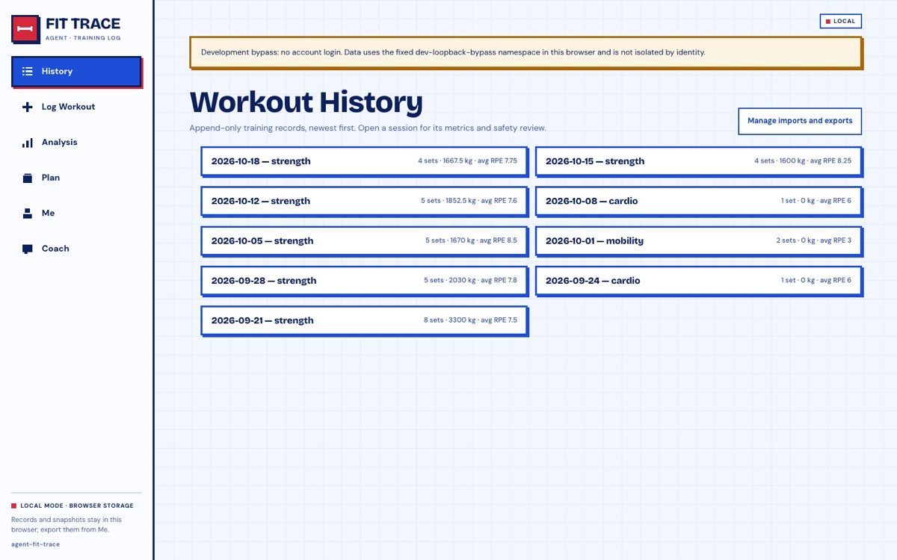
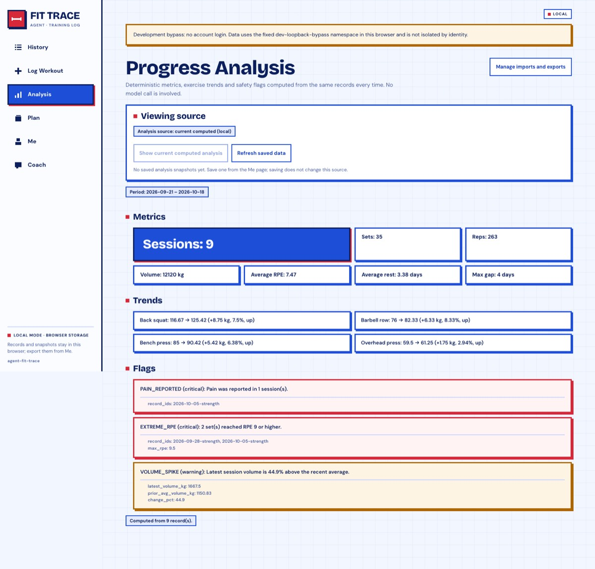
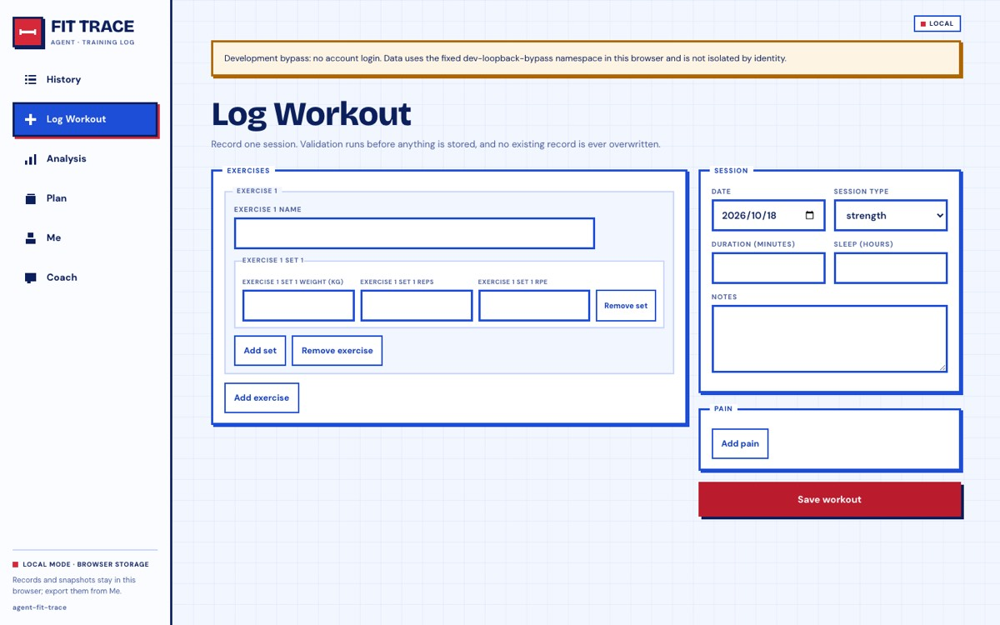
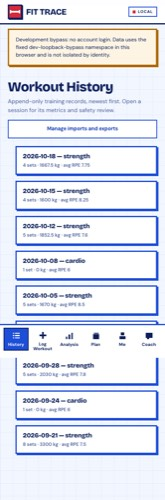
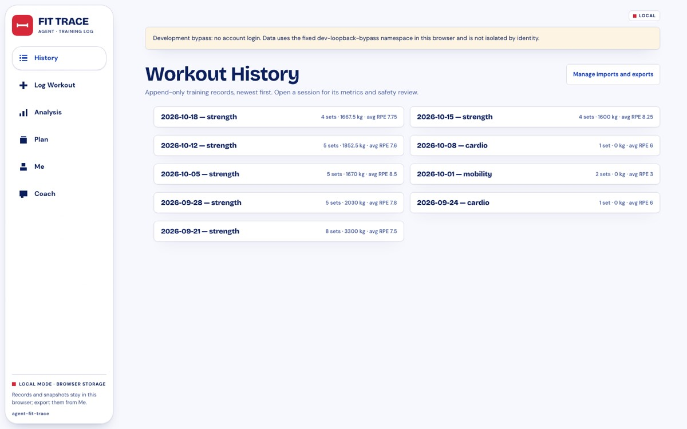
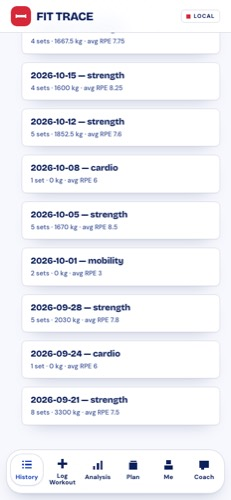
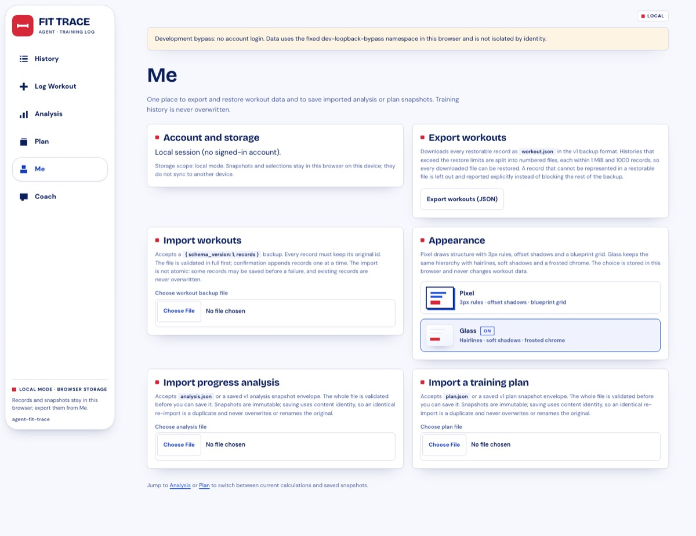
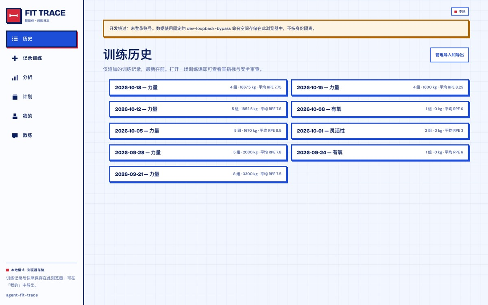
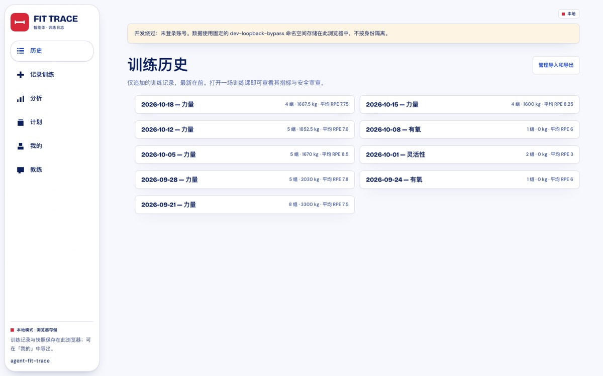
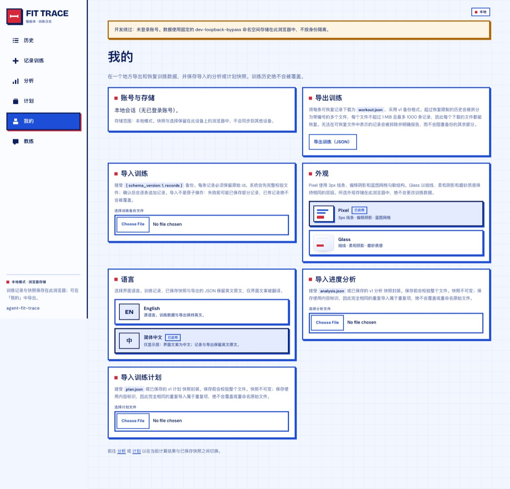

# UI design system

This document records the visual system used by `app/` and the rules for
extending it. It is a presentation contract only: behaviour, data access and
product copy stay governed by [`docs/mvp-design.md`](mvp-design.md) and
[`docs/app-dev-modes.md`](app-dev-modes.md).

## Provenance

The system is adapted from the **FORGE Fit Trace** responsive prototype, used
as a *style reference only*. No prototype page content, demo data, local-storage
keys, language layer or theme switcher was copied. The prototype and this app
happen to share the same six destinations (History, Log, Analysis, Plan, Coach,
Me); the restyle keeps this app's own information architecture, validation
states, auth gates and safety semantics.

Two skins share one token set: **Pixel** (the default, hard 3px rules and
offset shadows) and **Glass** (hairlines, soft diffusion and a frosted chrome).
Both are adapted from the same reference; neither changes the DOM or behaviour.
The interface is English-source with a Simplified Chinese display layer.

Both typefaces are self-hosted (SIL OFL 1.1, licenses in
`app/src/assets/fonts/`):

- **Bricolage Grotesque** — display face, weights 700–800.
- **DM Sans** — body face, weights 100–1000, used with `tabular-nums` for
  figures. No separate mono family is introduced.

## Principles

1. **Structure is drawn, not shaded.** 3px ink/blue rules, hard offset shadows,
   square corners (`border-radius: 0`), no blur, no gradients, no grey cards.
2. **Blue is structure; red is punctuation.** Blue carries navigation, borders
   and section markers. Red is reserved for the one primary action, destructive
   actions and urgent safety states. Amber marks warnings that must never read
   as the red action colour.
3. **Content cards are opaque paper.** The blueprint grid lives on the
   workspace behind the content, never through it: text always sits on a pure
   white surface.
4. **Pixel pictograms only.** Navigation icons are rect-only SVG on a 24-unit
   grid with `shape-rendering="crispEdges"`, no strokes and no rounded caps.
   Icons are `aria-hidden`; the adjacent label always carries the name.
5. **Touch first.** Interactive controls are at least 44px in their interactive
   dimension, with a visible 3px focus ring at all sizes.

## Tokens

Defined once in `app/src/styles/tokens.css`.

| Token | Value | Role |
| --- | --- | --- |
| `--bg` | `oklch(100% 0 0)` | Card and input paper |
| `--shell` | `oklch(97.2% 0.012 268)` | Workspace ground |
| `--soft` | `oklch(94.1% 0.0281 270.4)` | Tinted well, hover fill |
| `--pale` | `oklch(88% 0.0585 271.3)` | Hairline, disabled edge |
| `--fg` | `oklch(27% 0.1121 265.3)` | Ink: text, structural rules |
| `--muted` | `oklch(49.9% 0.104 268.5)` | Secondary copy, labels |
| `--border` | `oklch(48.8% 0.2172 264.4)` | Blue structure |
| `--blue-deep` | `oklch(43% 0.2 264.4)` | Blue hover / small blue type |
| `--accent` | `oklch(57% 0.2068 22.6)` | Red punctuation |
| `--accent-deep` | `oklch(51% 0.19 22.6)` | Primary button fill (AA on white) |
| `--warn` / `--warn-soft` | `oklch(58% 0.13 65)` / `oklch(97% 0.025 80)` | Warning states |
| `--grid` | `oklch(48.8% 0.2172 264.4 / 0.06)` | 30px blueprint grid |

Structure and layout tokens: `--border-w` 3px, `--shadow-blue` 4px 4px 0,
`--shadow-blue-sm` 3px 3px 0, `--shadow-ink` 3px 3px 0, `--shadow-red` /
`--shadow-red-sm`, `--nav-w` 248px, `--content-max` 1180px,
`--content-narrow` 860px, `--page-pad` `clamp(22px, 4vw, 56px)`.

## Type scale

| Role | Family | Size / line-height |
| --- | --- | --- |
| Page title (`h1`) | Bricolage 800 | `clamp(34px, 4.6vw, 48px)` / 1 |
| Section title (`h2`) | Bricolage 800 | 21px / 1.1 with a red square marker |
| Card title (`h3`) | Bricolage 700 | 15px / 1.25 |
| Lede | DM Sans | 13.5px / 1.5, `--muted`, max 74ch |
| Body | DM Sans | 15px / 1.45 |
| Form label | DM Sans 700 | 10px, uppercase, 0.09em tracking |
| Meta / chip | DM Sans 600–700 | 9.5–11.5px, tabular figures |
| Primary button | DM Sans 700 | 14px, min-height 50px |

## Shell and breakpoints

One navigation element at every width; it never duplicates in the DOM.

| Width | Navigation | Content |
| --- | --- | --- |
| ≥ 1280 | 248px left panel, icon + label | content cap 1180px |
| 1024–1279 | 232px left panel | same |
| 900–1023 | 92px left rail, icon above 10.5px label; footer hidden | single column |
| 601–899 | bottom dock, icon above label, 54px targets | 880px column |
| ≤ 600 | bottom dock | 18px gutters, single column |

The app bar is sticky below 900px and shows the compact brand plus the runtime
mode badge and account controls. Above 900px the account controls float in the
top-right of the workspace column; the side panel carries brand, destinations
and data-scope disclosure.

The workspace ground is a 30px blueprint grid in `--grid`. Every card drawn on
it stays pure white.

## Component recipes

Implementation: `app/src/styles/controls.css`, `shell.css`, `screens-data.css`,
`screens-account.css`, with the Glass overrides in `glass.css`.

- **Primary action** — `button[type="submit"]`: red fill (`--accent-deep`),
  3px border, 4px ink offset shadow; hover brightens to `--accent`; active
  translates 2px. One per form.
- **Secondary/ghost** — plain `button` and `.btn-ghost` links: white fill,
  2px blue rule, blue label; hover tinted `--soft` with ink rule.
- **Surfaces** — `.data-card`, `.artifact-source`, `.plan-adoption`,
  `.plan-recommendation`, `.me-section`, `.summary-exercise`, `.empty-state`,
  `.coach-text`: white paper, 3px blue rule, 3px blue offset shadow, 14–16px
  padding.
- **Inputs** — 3px blue rule, 46px min-height, 14px semibold value; focus turns
  the rule ink and adds an inset ink ring. Labels are uppercase micro-caps.
- **Chips** — machine metadata (period, source, evidence) is a 2px-blue chip
  with a tinted background; evidence chips inside plan recommendations are
  9.5px pale-bordered tags.
- **Safety** — `[data-safety]` gets a 3px colored left rule and a text badge
  (`Extreme effort`, `Pain reported`), so severity never depends on colour
  alone. Flag cards tint and shadow by `data-flag-severity`
  (`critical` red, `warning` amber, `info` blue tint).
- **Feedback** — `.validation-summary` is a red-ruled alert with a red offset
  shadow; `.validation-warnings` is the amber equivalent. `.care-prompt` is the
  strongest red surface.

## Themes

One token set, two skins. The choice is a **display preference**, stored under
its own browser key (`pi-fit-trace:theme:v1`) and never written into a workout
record, snapshot, export or content digest. It survives data resets and
account switches.

- **Switch location:** exactly one place — **Me → Appearance**. The navigation
  stays a pure destination list. Each option is a native button with
  `aria-pressed`, a miniature structural preview and an `On` flag.
- **No first-paint flash:** `app/index.html` applies the stored skin to
  `<html data-theme>` before the stylesheet and bundle load; `main.tsx` applies
  the same value on boot and the hook re-applies it on mount.
- **Invalid or unreadable storage** falls back to Pixel. A failed write keeps
  the in-page choice for that page load.

| | **Pixel** (default) | **Glass** |
| --- | --- | --- |
| Rules | 3px ink/blue borders | 1px hairlines (`--hair`) |
| Depth | 3–5px hard offset shadows | soft diffusion (`--soft-shadow`) |
| Corners | square | 8px cards / 6px controls |
| Ground | 30px blueprint grid | flat `oklch(98% 0.006 268)` |
| Labels | 11px uppercase, 0.1em tracking | 11px sentence case, 0.01em |
| Active nav | blue block, red offset shadow | white glass capsule with rim |
| Brand mark | red square, ink border, offset shadow | red rounded square, no border |
| Chrome | opaque panel / app bar | translucent tint + blur + two rims |

**Glass is chrome-only.** The material appears only where something floats over
scrolling content: the side panel, the mobile app bar and the bottom dock.
Record cards, analysis panels, forms and imported snapshots stay opaque in both
skins — a card whose text sits on frosted content loses the contrast its text
needs. Every glass surface carries a tint *under* the blur, so legibility is a
fixed value instead of whatever happens to scroll behind it.

Honest fallbacks: `prefers-reduced-transparency: reduce` and browsers without
`backdrop-filter` drop to a solid panel tint; nothing becomes unreadable. The
focus ring keeps its own `--focus-w` token (3px) so thinning Glass borders
never weakens keyboard focus.

## Interface language

English is the source language; Simplified Chinese is a **display layer**, not a
second data model. The boundary is the design:

- **Translated at render time:** chrome, labels, empty/loading/error states,
  buttons, helper copy, navigation, auth and account screens, validation
  messages, import warnings, safety-flag messages, plan recommendations and
  plan safety notes.
- **Canonical English, never translated in storage:** workout records and
  notes, exercise names as typed, saved snapshot payloads, plan `detail` /
  `reason` / `safety_notes` strings inside the payload, adopted digests and
  exported JSON. A content digest must never depend on who is reading it.
- **Rebuilt, not looked up.** Deterministic content is reconstructed from its
  stable code plus evidence at render time: an analysis flag from
  `code + evidence`, a recommendation from `action + evidence`, a safety note
  or validation message from its source string. Unknown codes, missing
  evidence and user-authored notes fall back to the original English string —
  a translation never invents numbers.
- **Imported copy stays authored.** A recommendation is only rebuilt when its
  English `detail`/`reason` exactly match the local generator's template for
  that action and evidence. An imported plan may reuse an action code with a
  different instruction; such text is preserved verbatim.
- **UI copy is looked up by its exact English source** in a per-area Chinese
  table. A missing entry falls back to English instead of showing a raw key.
- **Switching never rewrites data.** Changing language does not touch the
  workout store, snapshots, adoption or export payloads, so it cannot
  invalidate a saved plan confirmation.

The switch lives once in **Me → Language** (English / 简体中文), persists under
its own browser key (`pi-fit-trace:lang:v1`), and is applied to
`<html lang>` + `data-lang` before first paint. A failed preference write keeps
the in-page choice, exactly like the skin preference.

**Chinese typography.** Bricolage Grotesque and DM Sans carry no CJK glyphs, so
Chinese swaps the stacks rather than letting the browser choose a fallback per
glyph run; the Latin face stays first so numbers, `kg`, `RPE` and English
exercise names keep their designed shapes. Chinese also needs more leading and
less tracking: the page title drops to `clamp(27px, 3.6vw, 36px)` with 1.2
leading, body copy moves to 1.6–1.75 leading, and the micro-caps labels lose
their 0.1em tracking.

**Not translated:** coach/model answers (they are generated content, not a
deterministic message), backend/provider labels and transport error text;
these stay as produced. An error string captured into local state keeps the
language it was produced in (all render-time copy is reactive).

## Accessibility and test constraints

The restyle deliberately kept the semantics the test suite pins:

- Exactly one `h1` per screen; workout exercise names stay `h3`.
- `<nav aria-label="Primary">` with the same accessible link names
  (`History`, `Log Workout`, `Analysis`, `Plan`, `Me`, conditional `Coach`).
- Account controls stay directly reachable (no collapsed-only menus), and the
  guest sign-out flow stays two-step.
- Native form controls keep their existing labels; no new unlabeled inputs.
- Text that tests match is never split into per-word child elements
  (`getByText` only reads direct text nodes); decoration is added as
  `aria-hidden` SVG, wrappers or CSS, never by rewriting the copy.
- The single `role="status"` / `role="alert"` assumptions in loading and error
  states are preserved: the shell adds no global live region.

## Known gaps / intentionally not ported

- **No third skin.** The reference's earlier flat *Clean* skin was not ported;
  Pixel and Glass are the only choices.
- **Two languages only.** English is the source and Simplified Chinese is the
  display layer; there is no third language table yet.
- **Coach answers stay as generated.** Model output is content, not a
  deterministic message, so it is not translated.
- **Captured errors are not reactive.** An error message stored in component
  state keeps the language in which it was produced; render-time copy updates
  immediately.
- **Light mode only.** There is no dark theme token set.
- **No charts.** The app's deterministic analysis renders metrics, trends and
  flags; a bar chart is out of scope for a visual restyle.
